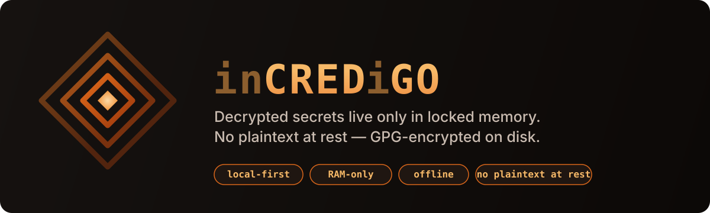
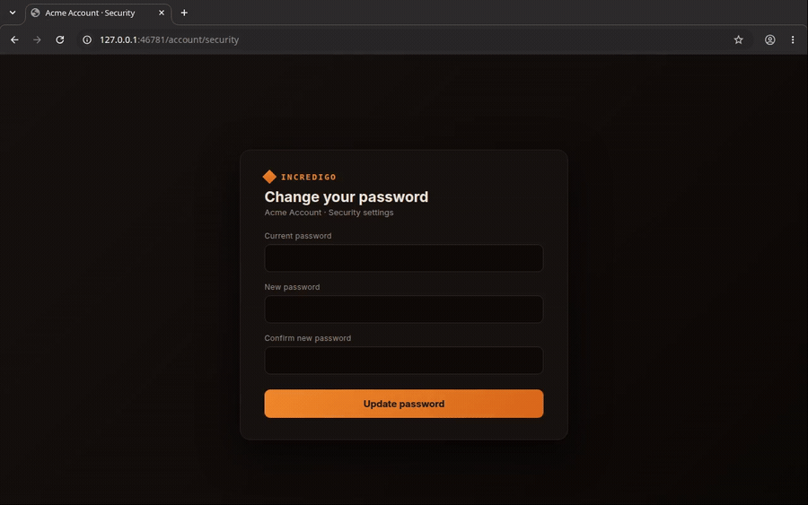

<div align="center">



# Incredigo

**No plaintext at rest.** Decrypted secrets live only in locked, non-swappable RAM; on disk they're GPG-encrypted in gopass.

*Local-first, encrypted, RAM-only credential custody — shipped as the `incredigo` CLI.*

</div>

## Vision

**Incredigo** — an **incred**ible **cred**ential rotation automation, **i**n **Go**.

> How long would it take to rotate *every* credential on your machine?
> Honestly, I get kinda sick just thinking about it.

The design has **two parts**:

1. **The everyday user** who reuses the same password everywhere — with this tool as
   the driver behind a managed security service.
2. **A concept/framework for *ethical* research** into a novel kind of worm: one that
   can find and edit credentials to help it spread more rapidly.

**Where it starts:** the secrets developers create that are changeable straight from the
command line. *(Current status: early-stage dev — the `cyber-malware-path`.)*

**The end goal:** pair browser automation with machine learning to automate
browser-based password resets. *(The `mass-consumer-market`.)*

I have faith this could be lucrative for the community. I wasn't planning on
open-sourcing it — but I realized I really want help and collaboration.

*Malware bless — technicals below.*

```
+------------------------------------------------------------+
|    /\      INCREDIGO                                       |
|   /<>\     in-CRED-i-GO : credentials, in Go               |
|   \<>/     Decrypted secrets live in locked RAM.           |
|    \/      No plaintext at rest; encrypted on disk.        |
+------------------------------------------------------------+
```

Incredigo finds credentials scattered across the usual places
(`~/.aws/credentials`, `.env` files, `~/.netrc`, SSH keys,
`~/.docker/config.json`, kubeconfig, gitea/git tokens…), custodies them in a
[gopass](https://www.gopass.pw/) (GPG-backed) store **without ever writing
plaintext to disk**, tells you which ones are stale, **rotates what's
scriptable**, and hands you a guided worklist for the rest.

- 🔒 **No plaintext at rest.** Disk only ever holds GPG blobs (gopass) or
  sealed backups (age / hmac / openssl).
- 🧠 **RAM-only secrets.** Decrypted material lives in `mlock`'d, non-dumpable,
  zeroized memory ([memguard](https://github.com/awnumar/memguard)).
- 👀 **Read-only discovery.** Scanners never touch your source files.
- ♻️ **Backup-gated rotation.** No rotation runs without a verified sealed backup
  first; new secret is proven to authenticate before the old one is revoked.
- 🧩 **Hackable.** A new scanner, sealer, or rotation driver is one file each.

See [`DESIGN.md`](DESIGN.md) for architecture + threat model,
[`VISION.md`](VISION.md) for who it's for, and [`docs/MARKET.md`](docs/MARKET.md)
for positioning.

## Who it's for

The **vibe coder** — the fast-moving AI-assisted builder who ships in a weekend
and accumulates dozens of credentials (`.env` keys, `sk_live`, `DATABASE_URL`,
GitHub PATs, AWS keys) each *generated once, pasted in, and never rotated*.
Incredigo finds that sprawl, custodies it, backs it up, rotates what's scriptable,
and guides the human through the rest — before a forgotten key becomes a breach.

## Status (2026-07)

**v1 custody pipeline: done.** discover → RAM vault → migrate → status →
sealed export/import. 9 scanners; sealers age (default) / hmac / openssl.

**Rotation: 22 drivers + wired Mode A `--execute` spine.** All self-register.
`rotate --execute` runs only behind `INCREDIGO_ALLOW_EXECUTE=1` **and** a
mandatory verified-backup gate, and only drivers proven against real target
software run by default.

Proof status is tracked as **data** ([`internal/rotate/proofs.go`](internal/rotate/proofs.go),
mirrored in [`docs/ROTATION-PROOFS.md`](docs/ROTATION-PROOFS.md), surfaced as a
`PROOF` column in the CLI):

| Level | Count | Meaning |
|---|---|---|
| **LIVE-VM** | 8 | cutover proven against **real** target software in a sandbox VM: postgres, mysql, redis, mongo, wireguard, gitea, appsecret, k8s |
| **MOCK-ONLY** | 14 | proven only against an emulator/mock (httptest, moto): aws, sshkey, openwrt, mullvad, cloudflare, ghactions, gitlab, npm, gcp, twilio, flyio, resend, vercel, sendgrid |
| **LIVE-REAL** | 0 | **no real, host-owned credential has ever been rotated** — this remains gated behind explicit per-credential authorization |

**Guided manual layer: done.** `incredigo worklist` / `incredigo guide` (TUI)
emit a secrets-free checklist of change-URLs (49 curated sites + RFC 8615).

**Phase B (password-manager / browser turnover): scaffolded, not wired.** 12
adapters + pwgen + staging exist; `passwords pw-*` flow is incomplete.

Tests: **247 pass, `-race` clean, 13 packages.** Coverage highlights: vault/worklist
100%, policy 95%, sink 85%, tui 88%; `cmd/incredigo` (34%) is the weakest and the
next test target.

## Build

Requires Go 1.22+.

```sh
go build ./cmd/incredigo          # or: make build
go test -race ./...               # 247 tests, -race clean
```

## Usage

```sh
incredigo scan --dry-run                        # see what's out there (no secrets printed)
incredigo migrate --prefix imported/ --dedupe   # custody into gopass, no plaintext on disk
incredigo status                                # age vs policy
incredigo export --out ~/incredigo-backup.age   # sealed backup (age)
incredigo worklist --out rotate.md              # guided checklist for manual rotations
incredigo guide                                 # TUI walk-through of the worklist

# rotation (Mode A — rotate what's already in gopass):
incredigo rotate --dry-run --prefix imported/ --blast   # plan + blast radius, touches nothing
INCREDIGO_ALLOW_EXECUTE=1 incredigo rotate --execute --prefix imported/
```

`--execute` is refused unless `INCREDIGO_ALLOW_EXECUTE=1` is set; it always runs
the backup gate first, and skips any driver whose proof is below `LIVE-VM` unless
you pass `--allow-mock-proven`.

## Reproduce the LIVE-VM proofs

The 8 `LIVE-VM` claims are reproducible from a clean machine — see
[`lab/README.md`](lab/README.md). The scripts stand up **real** target software
(PostgreSQL, MariaDB, redis, mongod, wireguard, Gitea, k3s) in a throwaway VM and
rotate **fake** credentials in an **isolated** gopass store. Nothing there can
touch a real store or provider.

## Browser-based rotation (Phase A engine)

The site-side rotation engine ([`internal/browserrot`](internal/browserrot)) drives a
**real** headless Chromium end-to-end — no language model in the loop:

<div align="center">



</div>

RFC 8615 discovery (`/.well-known/change-password`) → inject the old + a freshly-minted
new password into the form over CDP → submit and read the success marker → **re-login to
prove the new secret authenticates** before the old one is trusted as revoked. Recorded
above against a **fake** credential on a **local throwaway** site — this is the engine's
`LIVE-VM` proof (reproduce with [`lab/lab-provision-browserrot.sh`](lab/lab-provision-browserrot.sh)).
A real-site selector table stays `UNPROVEN` until run against that site, and the engine
is deliberately **not** auto-wired into production `rotate`.

## Safety rules (this tool holds real credentials)

1. **Backup before rotate, always.** No rotation runs without a verified sealed
   backup of the affected entries first; the gate aborts on any backup/verify failure.
2. **Verify-new-before-revoke-old.** Order is backup → rotate → verify the new
   secret authenticates → store → re-read → *only then* revoke the old.
3. **No plaintext secrets on disk, ever.** Secrets live only in the memguard vault.
   Browser passwords become a worklist of non-secret metadata, never a `.txt` dump.
4. **Self-owned only.** Automation targets only your own accounts, with your
   authorization. It never bypasses MFA/CAPTCHA — it hands off to the human.
5. **Dry-run by default; destructive steps are opt-in, audited, reversible.**
6. **The GPG passphrase is the root of trust.** Lose it → everything is
   unrecoverable; leak it → everything is exposed. Back up the GPG key; use a
   strong passphrase.

## Layout

| Path | Purpose |
|---|---|
| `cmd/incredigo` | cobra CLI: scan, migrate, status, export, import, rotate, worklist, guide, passwords |
| `internal/vault` | RAM-only secret arena (memguard: mlock / DONTDUMP / zeroize) |
| `internal/discover` | scanner registry + one file per source |
| `internal/sink` | gopass writer + bundle framing + Sealer (age / hmac / openssl) |
| `internal/policy` | expiry engine |
| `internal/audit` | redacted append-only JSONL log |
| `internal/rotate` | Rotator interface + mandatory backup gate + 22 drivers + proofs-as-data |
| `internal/blast` | read-only "which files consume this credential" map |
| `internal/links` / `worklist` / `tui` | guided manual-rotation layer |
| `internal/pwstore` / `pwgen` | Phase B password-manager adapters (scaffolded) |
| `lab/` | reproducible LIVE-VM / mock rotation proofs (fake creds) |

## Documentation

- [`DESIGN.md`](DESIGN.md) — architecture + threat model
- [`VISION.md`](VISION.md) — who it's for + the mission
- [`docs/MARKET.md`](docs/MARKET.md) — competitive landscape + positioning
- [`docs/SECURITY.md`](docs/SECURITY.md) — security posture + reporting
- [`docs/ROTATION-PROOFS.md`](docs/ROTATION-PROOFS.md) — how each driver was validated
- [`docs/ROADMAP.md`](docs/ROADMAP.md) — where it's going
- [`docs/ADDING_A_SCANNER.md`](docs/ADDING_A_SCANNER.md) — contributor guide (one file per source)

## Contributing

Adding a source is intentionally easy — see
[`docs/ADDING_A_SCANNER.md`](docs/ADDING_A_SCANNER.md). New code ships with tests
(table-driven scanners; leak-checks asserting no secret substring reaches
identity/metadata/logs).

## License

Source-available under the [Incredigo Source-Available License](LICENSE):
free for personal, educational, research, and internal **non-commercial** use,
**attribution required** for any fork or redistribution, and **commercial /
monetized use requires a separate royalty-bearing license** from the author.
This is not an OSI open-source license.
